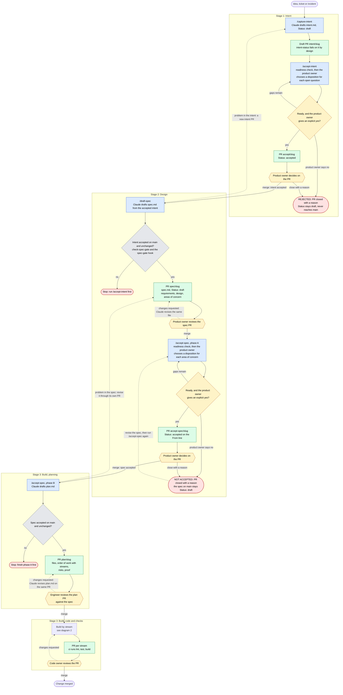
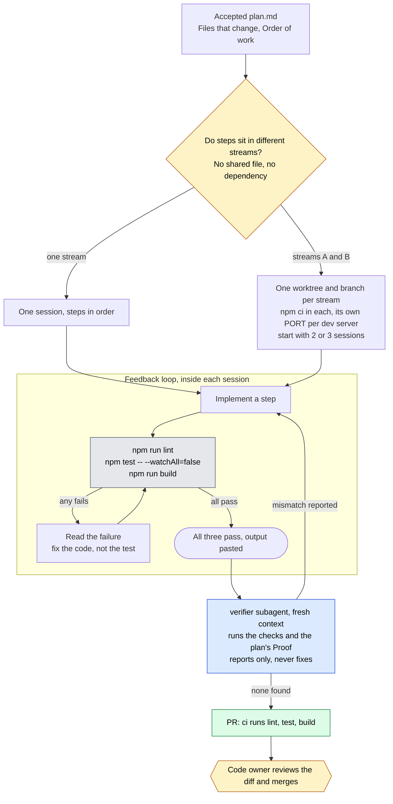
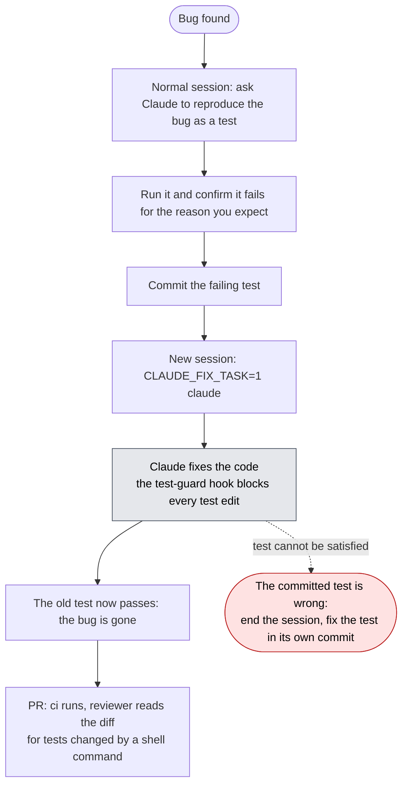
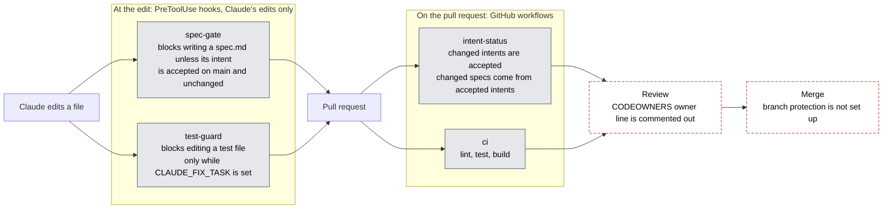

# The workflow in pictures

How one change moves from an idea to merged code, who decides at each point, and where the checks sit. For the commands to type at each step, see [README.md](README.md). The diagrams are Mermaid, which GitHub renders. A plain-text version is at the bottom for editors that do not.

State below was checked on 2026-11-06.

**How to read them**
- Blue boxes are Claude skills. Green boxes are the artifact a skill puts in a pull request. Amber hexagons and diamonds are human decisions. Grey diamonds are checks run by a script. Red rounded boxes are stops and rejections.
- **A skill never merges or closes a PR on its own.** Every amber hexagon is a person, and each one has a way to say no. See "How a person says no" below the first diagram.
- Dashed arrows are back-steps, not the normal path.

## 1. One change, end to end



**What each status means**

| File | Status is on | `draft` | `accepted` |
|---|---|---|---|
| `intent.md` | the `Author:` line | still a proposal, on a PR | merged into `main` with `Status: accepted`. CI and the scripts read this line. |
| `spec.md` | the `From:` line | merged, but the product owner has not accepted it | the accept-spec PR is merged. Nothing in CI reads this line yet. |
| `plan.md` | the `From:` line | always. Nobody is defined to accept a plan, and there is no gate. | not used |

**How a person says no**

| Where | Who | How to say no | What happens |
|---|---|---|---|
| Intent, `/accept-intent` | product owner | Answer no to Claude's final question, or close the PR without merging. Say why in a comment. | Claude records the answer on the PR as a comment. `Status` stays `draft` and the intent never reaches `main`. The closed PR is the record, and counts against the survival rate. |
| Spec review | product owner | Comment on the PR and have Claude revise the same file. If the problem is in the intent, open a new intent PR. | Further commits on the same PR. The spec does not patch around a bad intent. |
| Spec acceptance, `/accept-spec` phase A | product owner | Answer no to Claude's final question, or close the accept-spec PR with a reason. | Claude records the answer on the PR as a comment. The spec on `main` stays `draft`. Revise it, then run `/accept-spec` again. |
| Plan review | engineer | Comment on the PR. Claude revises `plan.md` on the same PR. | Further commits on the same PR. No accept or reject gate is defined for a plan. |
| Code | code owner | Request changes, or close the PR, as in any review. | Standard review. |

Claude offers to draft the closing comment, but never closes a PR unless asked.

**Not defined anywhere in the repo**
- Rejecting a plan outright. Only "changes requested" exists.
- Withdrawing an intent or spec after it was merged as accepted. The `intent-status` check on `main` requires every intent there to be `accepted`, so setting one back to `draft` would fail it.
- Who may say no. `.github/CODEOWNERS` has its owner line commented out, so nothing stops anyone with write access from merging or closing these PRs. See [enforcement.md](enforcement.md).

## 2. Building from the plan



**Fixing a bug** swaps the middle for a stricter loop, so the agent cannot weaken the test that proves the fix.



## 3. Where the checks sit



Dashed red boxes are controls that are written but not switched on. Until they are, nothing stops a PR's author from merging their own PR, and neither workflow is a required check. A file written by a shell command (`sed`, `tee`, `git checkout`) does not trigger either hook, so the PR checks and the reviewer are the backstop. Details in [enforcement.md](enforcement.md).

## Plain-text version

```
 idea, ticket or incident
          |
          v
 /capture-intent ----------> draft PR   intent/<slug>
          |
          v
 /accept-intent ----------> readiness check; product owner decides, explicit yes
          |                  PR          accept/<slug>
          |                  NO? close the PR with a reason: REJECTED, stays draft, never on main
          v
 [MERGE: INTENT ACCEPTED]    by the product owner
          |
          v
 /draft-spec -------------> gate: intent accepted on main and unchanged
          |                  PR          spec/<slug>     (Status: draft)
          v
 [MERGE]                     product owner reviews the areas of concern first
          |                  changes requested? Claude revises the same file on the same PR
          |
          v
 /accept-spec  phase A ---> readiness check; product owner decides, explicit yes
          |                  PR          accept-spec/<slug>
          |                  NO? close the PR with a reason: spec stays draft on main,
          |                      revise it, then run /accept-spec again
          v
 [MERGE: SPEC ACCEPTED]      by the product owner
          |
          v
 /accept-spec  phase B ---> gate: spec accepted on main and unchanged
          |                  PR          plan/<slug>     (plan.md)
          v
 [MERGE: PLAN REVIEWED]      engineer checks it against the spec, line by line
          |                  changes requested? Claude revises plan.md on the same PR
          |
          v
 build, one worktree per stream
          |   loop: lint, test, build -> fix -> repeat
          v   then the verifier subagent in a fresh context
 PR per stream  (ci: lint, test, build)
          |
          v
 [MERGE]                     code owner reviews the diff
                             changes requested? back to the build step

 Back-steps: a problem in the intent is a new intent PR. A problem in the spec found
 while planning is a revision of the spec through its own PR. A plan never patches
 around either.
```
